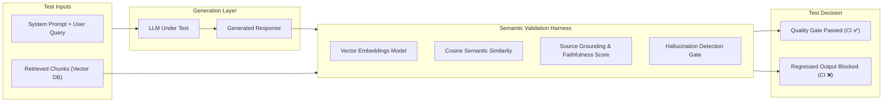

# AI Vector Validation Suite

> **Continuous Evaluation and Benchmarking Suite for RAG Pipelines, Vector Embeddings & LLM Output Faithfulness.**

[](https://github.com/marttinroman/ai-vector-validation-suite/actions)
[](https://www.python.org/)
[](https://docs.pytest.org/)
[](LICENSE.md)
[](https://marttinroman.github.io)

---

## 1. Overview & Business Problem

Generative AI applications (LLM/RAG) are fundamentally non-deterministic. Software engineering teams routinely face production risks that cannot be caught with traditional unit testing:

- **Prompt Drift:** A slight modification to system prompts or foundational model weights degrades answer quality without triggering fatal errors.
- **Hallucinations:** Models fabricate authoritative-sounding facts unsupported by the retrieved reference chunks.
- **Source Faithfulness Erosion:** Answers fail to attribute or align with source context in vector databases (Pinecone, Qdrant, Milvus, Chroma).

**The Solution:** The **AI Vector Validation Suite** provides automated, CI-ready semantic assertions for LLM pipelines using cosine distance thresholds, context faithfulness scoring, and hallucination detection fences.

---

## 2. Evaluation Architecture



---

## 3. Metrics Evaluated

| Metric | Measurement Method | Passing Threshold (Default) |
| ------ | ------------------ | --------------------------- |
| **Semantic Similarity** | Cosine distance between response and reference ground-truth embeddings | $\ge 0.85$ |
| **Source Faithfulness** | Proportion of response claims directly verified by retrieved chunks | $\ge 0.90$ |
| **Answer Relevance** | Alignment score between the generated output and original user prompt | $\ge 0.88$ |
| **Hallucination Detection** | Binary check for ungrounded entity/fact generation | $0\text{ hallucinations}$ |

---

## 4. Quickstart

### Prerequisites
- Python 3.11+
- Virtualenv or Conda

### Installation

```bash
# Clone the repository
git clone https://github.com/marttinroman/ai-vector-validation-suite.git
cd ai-vector-validation-suite

# Create and activate virtual environment
python3 -m venv .venv
source .venv/bin/activate

# Install dependencies
pip install -r requirements.txt
```

### Running Evaluation Benchmarks

```bash
# Run all semantic evaluation tests
pytest tests/ -v

# Run with detailed threshold reporting
pytest tests/test_rag_faithfulness.py --report=html

# Run specific hallucination fence test
pytest tests/test_hallucinations.py
```

---

## 5. Author & Contact

**Marttin Roman**  
*Senior QA Automation Engineer & SDET | AI-TestOps Specialist*  
- **Portfolio:** [marttinroman.github.io](https://marttinroman.github.io)  
- **LinkedIn:** [linkedin.com/in/marttinroman](https://linkedin.com/in/marttinroman)  
- **Email:** [marttinroman@gmail.com](mailto:marttinroman@gmail.com)  

---

## 6. License

Licensed under the [MIT License](LICENSE.md).
